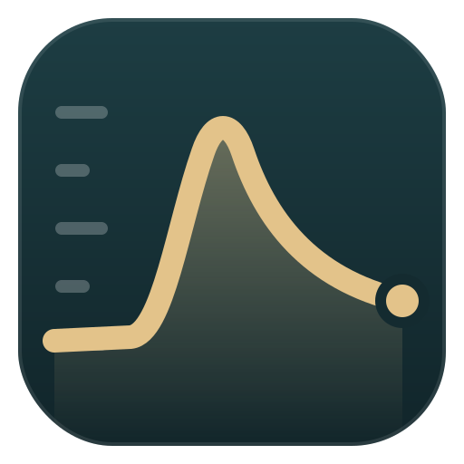
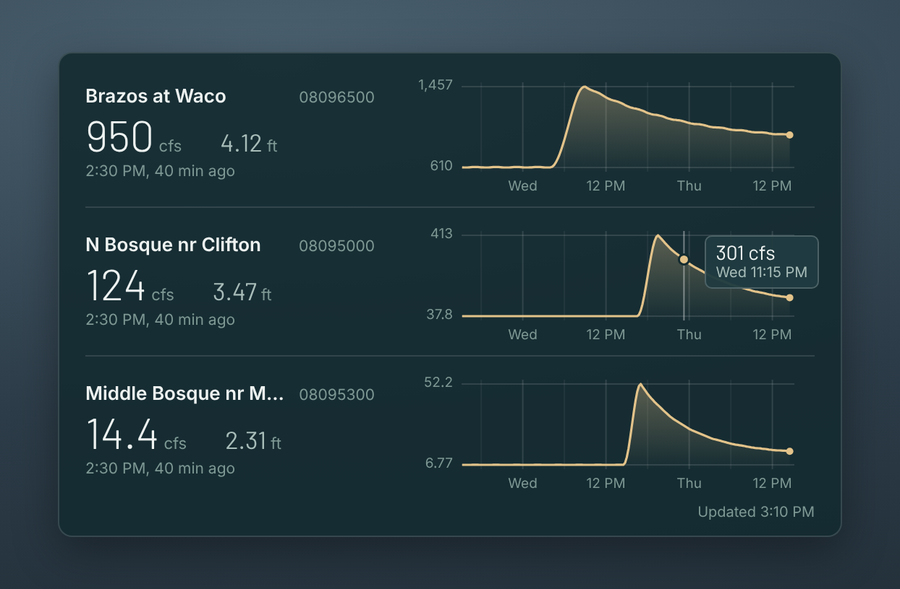

# Gage Widget



A small Windows desktop widget that shows the latest discharge and stage for the USGS stream gages you choose, with a 48-hour hydrograph for each. It sits on the desktop just above the wallpaper and stays visible through Show Desktop (Win+D).

<p align="center"></p>
<p align="center"><sub>Illustration drawn from the widget's layout code. The hydrographs are made-up values, not real readings.</sub></p>

## Install

Needs Windows 10 or 11 and the Windows PowerShell 5.1 that comes with it. Nothing else to install.

1. **Code > Download ZIP**, then extract it to a folder you can write to, such as Documents. The widget saves its settings in that folder.
2. Double-click `Create Gage Widget shortcut.cmd`. It puts a **Gage Widget** shortcut on your desktop.
3. Double-click **Gage Widget** to start it. To start it at login, copy the shortcut into the folder that opens from Win+R > `shell:startup`.

The script isn't signed, so the shortcut runs it with `-ExecutionPolicy Bypass`. It's one readable file: it contacts only `api.waterdata.usgs.gov` and writes two small settings files next to itself. The [user guide](docs/guide.md) covers first-run warnings, hover readouts, and troubleshooting.

## Configure

Most changes happen in the widget itself:

| To | Do this | Saved in |
|---|---|---|
| Add or remove gages | Right-click > **Manage gages...** and enter a USGS site number (8–15 digits) and a short name | `gage-widget-sites.json` |
| Reorder gages | Hover a gage and drag the dotted handle on its left | `gage-widget-sites.json` |
| Move the widget | Drag it | `gage-widget.pos` |
| Refresh or quit | Right-click > **Refresh now** or **Close** | |

Four settings sit at the top of `gage-widget.ps1`. Restart the widget after editing them.

| Setting | Default | What it does |
|---|---|---|
| `$DefaultSites` | three Waco-area gages | Starting gage list, used only until you first change the list in the widget |
| `$RefreshMinutes` | `5` | How often to check USGS for new readings |
| `$LogScale` | `$false` | `$true` draws the hydrographs on a log10 axis |
| `$ApiKey` | `$env:API_USGS_PAT` | Optional USGS API key, read from an environment variable (below) |

To start over, delete `gage-widget-sites.json` (gage list) or `gage-widget.pos` (position).

## Do I need a USGS API key?

Usually not for one widget. USGS limits how many requests each IP address can make per hour, and an API key raises that limit. USGS doesn't publish the limit without a key; [with a key it is 1,000 requests an hour](https://water.code-pages.usgs.gov/dataRetrieval/articles/Status.html). One widget makes at most about 24 requests an hour at the default refresh.

Get a free key if:

- several people run the widget on the same network (a campus or office often shares one public IP address, so everyone shares one allowance);
- you also pull USGS data with scripts from the same network; or
- the widget's footer says **USGS rate limit hit**.

To use one:

1. Request a key at <https://api.waterdata.usgs.gov/signup/>. It arrives by email.
2. Save it as a Windows environment variable for your account named `API_USGS_PAT`. In PowerShell:
   ```powershell
   [Environment]::SetEnvironmentVariable('API_USGS_PAT', 'paste-your-key-here', 'User')
   ```
   Or search Start for "Edit environment variables for your account" and add it there.
3. Close the widget and start it again. If it doesn't pick up the key, sign out and back in.

Keep the key out of the script and out of any repository, and give each person their own key, because everyone using a key shares its limit. The R and Python [dataRetrieval](https://github.com/DOI-USGS/dataRetrieval) packages read the same `API_USGS_PAT` variable, so one key covers both.

## Logging the data

The widget doesn't save readings; it holds only the last 48 hours in memory. You usually don't need it to, because USGS keeps the full record and you can download any period later. In R:

```r
library(dataRetrieval)

c("USGS-08096500", "USGS-08095000", "USGS-08095300") |>
  read_waterdata_continuous(parameter_code = c("00060", "00065"),   # discharge, stage
                            time = "P7D") |>                        # last 7 days
  saveRDS(sprintf("gages_%s.rds", Sys.Date()))
```

For a fixed period, use `time = c("2026-10-01", "2026-10-31")`. Each request can cover up to three years. Python users can do the same with `waterdata.get_continuous()` in [dataretrieval-python](https://github.com/DOI-USGS/dataretrieval-python).

Keep your own copy when you need the values as they stood at the time, for example to document a field or operations decision, because USGS may revise provisional values later. Run a script like the one above on a schedule (Windows Task Scheduler works) and keep each dated file.

## About the data

Readings come from the [USGS Water Data API](https://api.waterdata.usgs.gov/): the `latest-continuous` collection for the printed values and the `continuous` collection for the hydrographs. Recent USGS data are [provisional and subject to revision](https://waterdata.usgs.gov/provisional-data-statement/). The widget is a convenience display, not a flood-warning tool; for safety decisions, use the National Weather Service and local officials.

## Use of AI tools

Claude (Anthropic) [wrote the widget, the shortcut scripts, and the user guide, and] made the logo in October 2026[, to specifications from and with testing by Caleb Robbins]. In November 2026, Claude (Opus 5.5), accessed through claude.ai, reviewed the files for public release, added the optional API key, checked the USGS API-key and data-access documentation, wrote this README, and drew the illustration above from the widget's layout code. No restricted material was shared with AI tools. The record is in [ai-use/](ai-use), following the [CRASR AI-use policy](https://github.com/CRASR/ai-use). The maintainer takes full responsibility for the content.

## License

[MIT](LICENSE). Maintained by Caleb Robbins, Center for Reservoir and Aquatic Systems Research (CRASR), Baylor University.
